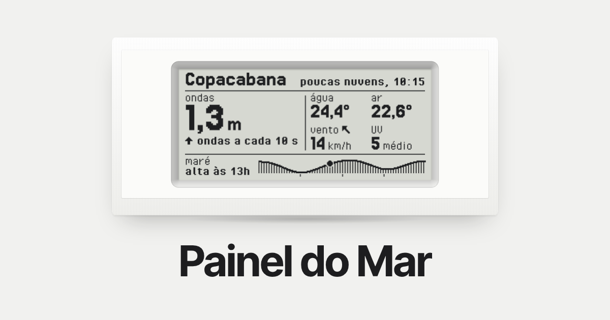

# Painel do Mar

Um painel de papel eletrônico que mostra o mar e o tempo de um lugar: altura, direção e período das ondas, temperatura da água e do ar, vento, índice UV e a curva da maré do dia. Ele funciona sozinho, sem servidor e sem aplicativo. O Wi-Fi e o lugar são configurados pelo celular, com um código QR que aparece na tela, e o firmware se atualiza pela internet.

Guia de configuração, para quem recebe um painel pronto: https://paineldomar.com.br

## Como funciona

Uma ESP32-C3 Super Mini busca os dados no [Open-Meteo](https://open-meteo.com) a cada 30 minutos e desenha a tela, uma e-ink WeAct de 2,9" preta e branca, com 296 × 128 pixels. O firmware é escrito em [ESPHome](https://esphome.io). O mar vem da API marinha do Open-Meteo, no ponto de mar mais próximo do lugar escolhido, e o resto vem da API de previsão. Longe do mar, a tela troca as ondas pela temperatura, a maré pelo nascer e pôr do sol, e os quadros que dependem do mar por sensação térmica, chuva prevista, vento e índice UV.

A placa serve uma página própria na rede da casa. Nela dá para trocar o lugar, o nome que aparece no alto e o que cada parte da tela mostra.

## Material

| Item | Quantidade | Observação |
|---|---|---|
| ESP32-C3 Super Mini | 1 | |
| Tela e-ink WeAct 2,9" preta e branca | 1 | Controlador SSD1680. Vem com um cabo de 8 fios. A versão com vermelho usa outro controlador e não funciona com este firmware. |
| Barra de pinos 2,54 mm com 8 pinos | 2 | Costuma vir com a Super Mini. |
| Cabo USB-C e carregador de 5 V | 1 | Qualquer carregador de celular de 1 A ou mais. Um carregador com saída USB-A e cabo USB-A para USB-C funciona com qualquer lote da Super Mini. Com cabo USB-C dos dois lados, algumas placas não ligam. |
| Caixa impressa em 3D | 1 | Três peças, uns 110 g de PLA. Ver [`case/`](case/). |

Ferramentas: ferro de solda, estanho e um computador com Chrome ou Edge para a primeira gravação.

## Ligações

Solde as barras de pinos na Super Mini e ligue os 8 fios do cabo da tela assim:

| Tela | Cor do fio no cabo da WeAct | Super Mini |
|---|---|---|
| `VCC` | vermelho | `3.3` |
| `GND` | preto | `G` |
| `SCL` | verde | `4` |
| `SDA` | amarelo | `6` |
| `CS` | azul | `7` |
| `D/C` | branco | `5` |
| `RES` | laranja | `3` |
| `BUSY` | roxo | `10` |

Se o seu cabo vier com outras cores, siga os nomes impressos na placa da tela.

## Gravar o firmware

1. Ligue a Super Mini no computador com um cabo USB-C que transmita dados.
2. Abra [web.esphome.io](https://web.esphome.io) no Chrome ou no Edge e clique em **Connect**.
3. Clique em **Install** e escolha o arquivo `painel-do-mar-<versão>.factory.bin` da pasta [`binarios/`](binarios/).
4. Ligue o painel num carregador e siga o guia em https://paineldomar.com.br.

Se a porta da placa aparecer e sumir da lista do navegador, segure o botão BOOT, aperte e solte o RESET e depois solte o BOOT.

Para compilar você mesmo, use o ESPHome 2026.9.1 ou mais novo e rode `esphome run firmware/painel-do-mar.yaml`. Versões mais antigas do ESPHome não leem as respostas do Open-Meteo.

## Atualização pela internet

O painel confere o [`manifest.json`](manifest.json) deste repositório 2 minutos depois de se conectar e, depois, a cada 6 horas. Se a versão do manifesto for diferente da gravada, ele baixa o arquivo `.ota.bin` de `binarios/`, confere o MD5, grava e reinicia. O Wi-Fi, o lugar e as escolhas da tela continuam salvos. Durante a gravação, a tela mostra "Atualizando".

Isso vale para qualquer painel gravado com o firmware daqui. Se você fizer um fork e mudar o firmware, troque o endereço em `manifesto`, no começo de `firmware/painel-do-mar.yaml`, pelo do seu repositório. Sem isso, o seu painel volta para a versão deste repositório na primeira atualização.

Para lançar uma versão nova:

1. Aumente `versao` em `firmware/painel-do-mar.yaml`.
2. Compile, grave num painel e confira que ele conecta e mostra os dados. Um firmware que não conecta no Wi-Fi não consegue baixar a correção, então nada é publicado sem rodar numa placa antes.
3. Rode `./scripts/publicar-atualizacao.sh firmware.ota.bin firmware.factory.bin "o que mudou"`. O script troca os arquivos de `binarios/`, escreve o `manifest.json` com o MD5, faz o commit e o push.

Quem pode publicar neste repositório consegue mandar firmware para todos os painéis, então a conta precisa de verificação em duas etapas.

## Estrutura

- [`firmware/painel-do-mar.yaml`](firmware/painel-do-mar.yaml): o firmware.
- [`firmware/pagina/`](firmware/pagina/): a página da placa já montada (`painel.js`), que o firmware embute com `js_include`.
- [`firmware/fonts/`](firmware/fonts/): Pixel Operator, usada pelo firmware, e Jersey 15, usada só por `pagina/glifos.py`. O firmware baixa a Jersey 15 do Google Fonts na compilação.
- [`pagina/`](pagina/): a fonte da página da placa. Ela desenha a tela pixel por pixel, igual ao aparelho, com as letras das fontes do firmware (`glifos.json`, gerado por `glifos.py`). Depois de mudar, rode `python3 pagina/montar.py` e compile o firmware.
- [`binarios/`](binarios/) e [`manifest.json`](manifest.json): a versão publicada, para gravar pelo USB (`.factory.bin`) e para a atualização pela internet (`.ota.bin`).
- [`scripts/publicar-atualizacao.sh`](scripts/publicar-atualizacao.sh): publica uma versão nova.
- [`case/`](case/): os STL da caixa e o código em Python que gera as peças.
- [`docs/`](docs/): o site https://paineldomar.com.br, servido pelo GitHub Pages. `docs/como-configurar.txt` é a versão em texto do guia.
- [`guia/`](guia/): a fonte do site. Depois de mudar `guia.src.html`, rode `python3 guia/montar.py`. Se o desenho da tela mudar no firmware, rode antes `python3 guia/gerar_telas.py`.

## Créditos

- Dados do [Open-Meteo](https://open-meteo.com), sob a licença CC BY 4.0. A API gratuita vale para uso não comercial.
- Fonte [Pixel Operator](https://notabug.org/HarvettFox96/ttf-pixeloperator), de Jayvee Enaguas, em domínio público (CC0).
- Fonte [Jersey 15](https://fonts.google.com/specimen/Jersey+15), de Sarah Cadigan-Fried, sob a SIL Open Font License.
- A caixa é inspirada no rádio-relógio Braun DN40, desenhado por Dieter Rams.
